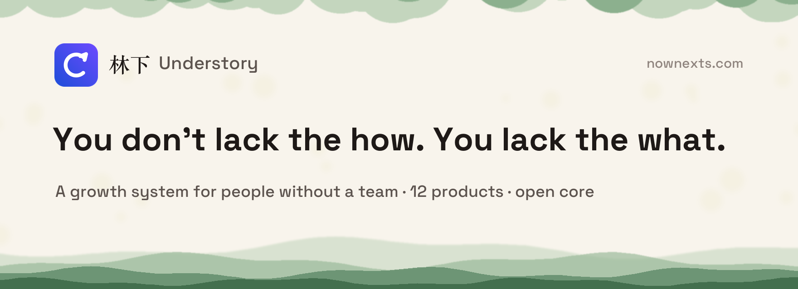

<p align="center">
  <a href="https://nownexts.com"></a>
</p>

<p align="center">
  <b>Most growth tools assume you have a team. Understory is built for people who don't.</b><br>
  It watches the signals, drafts the content and tracks who needs a follow-up. You make the calls; it does the work.
</p>

<p align="center">
  <a href="https://nownexts.com">Website</a> ·
  <a href="#the-product-family">Products</a> ·
  <a href="#quick-start">Get started free</a> ·
  <a href="docs/USAGE-GUIDE.md">Docs (Chinese)</a> ·
  <a href="README.md">中文</a>
</p>

<p align="center">
  <a href="https://nownexts.com"></a>
  <a href="LICENSE"></a>
  <a href="CHANGELOG.md"></a>
</p>

<p align="center"><sub>Made by Seven, ten years running growth · Open core, forever · Your data stays on your server</sub></p>

---

## Sound familiar?

- "I spend three hours a day hunting for topics and editing drafts. The decisions that matter never get my time."
- "I know what growth needs. I just can't tell which parts to hand to an agent and which to keep."
- "I tried a few tools. Every one of them ended with: I still have to do it myself."

Marketing automation assumes a marketing team. A CRM assumes salespeople. Analytics assumes an analyst.
Five tools, five jobs waiting for someone to feed them. **A one-person company was never short of tools. It's short of people.**

## What is Understory?

The understory is the layer beneath the forest canopy: easy to overlook, yet it keeps the whole forest growing. One-person companies are like that too.

Understory (林下) serves one kind of person: someone carrying a whole company alone.
AI means "nobody to do it" no longer means "it can't be done". We built twelve products in three layers. Wherever you're short of hands, pick the one that fills the gap.

## The product family

Each product runs on its own. They talk over public APIs, so you can unplug any one and the rest keep working.

**Entry layer: the whole system, lowest barrier**

| Product | What it does | For | Links |
|---|---|---|---|
| **OpenFlow** (开务) | Content, visitor data, automated outreach and checkout: a growth system one person can run | Solo founders and small teams who want the full set | [Page](https://nownexts.com/product/openflow) · [GitHub](https://github.com/sevenaaaaaaaaa/openflow) · [Self-host](#quick-start) |

**Flow layer: go deeper on one job**

| Product | What it does | For | Links |
|---|---|---|---|
| **MFlow** (风媒) | AI drafting, multi-channel publishing, light outreach. Keep your CMS, pick any model | Creators, online sellers | [Page](https://nownexts.com/product/mflow) · [GitHub](https://github.com/sevenaaaaaaaaa/mflow) · [Try it](https://nownexts.com/mflow/) |
| **WebsFlow** (魔块) | A landing-page workshop for paid traffic: build, launch, read the data, scale, all in a day | Media buyers, campaign managers | [Page](https://nownexts.com/product/webs-flow) · [GitHub](https://github.com/sevenaaaaaaaaa/websflow) · [Try it](https://nownexts.com/webflow/) |
| **UserLoop** (触级) | Tracking, identity merge and segments in one data hub that plugs into any marketing automation | Multi-channel teams, agencies | [Page](https://nownexts.com/product/userloop) · [GitHub](https://github.com/sevenaaaaaaaaa/userloop) |
| **inFlow** (洞澜) | Watches the outside world for you: trends, sentiment, competitors, delivered daily | Brands, content strategists | [Page](https://nownexts.com/product/inflow) · [GitHub](https://github.com/sevenaaaaaaaaa/inflow) |
| **PayFlow** (芭乐 Pay) | One line of code on any page: payments, subscriptions, referral commissions | Creators, indie developers | [Page](https://nownexts.com/product/payflow) · [GitHub](https://github.com/sevenaaaaaaaaa/payflow) |
| **LearnFlow** (林下学院) | Lessons, progress, quizzes and certificates, all from one dashboard | Instructors, coaches, cohort hosts | [Page](https://nownexts.com/product/learnflow) · [GitHub](https://github.com/sevenaaaaaaaaa/learnflow) |

**Studio layer: tools that live on your desktop**

| Product | What it does | For | Links |
|---|---|---|---|
| **Litmus** (鹿蕊) | A knowledge OS: you jot things down, AI organises them, everything stays plain Markdown on disk | Knowledge workers, developers | [Page](https://nownexts.com/product/litmus) · [GitHub](https://github.com/sevenaaaaaaaaa/litmus) · [Download](https://github.com/sevenaaaaaaaaa/litmus/releases/latest) |
| **Liana** (松萝) | A private keyboard: keystrokes never leave your device, zero telemetry, peer-to-peer encrypted sync | Privacy-minded power users | [Page](https://nownexts.com/product/liana) · [GitHub](https://github.com/sevenaaaaaaaaa/liana) · [Download](https://github.com/sevenaaaaaaaaa/liana/releases/latest) |
| **ConFlow** (成章) | Turn one video into a publishable article and a slide deck you can present | Content teams, educators | [Page](https://nownexts.com/product/conflow) · [GitHub](https://github.com/sevenaaaaaaaaa/V2HTML) |
| **LinkTo** (林可兔) | An email workspace: AI triage, summaries and reply drafts, with all data kept local | Heavy email users | [Page](https://nownexts.com/product/linkto) · [GitHub](https://github.com/sevenaaaaaaaaa/linkto) · [Download](https://github.com/sevenaaaaaaaaa/linkto/releases/latest) |
| **ZeroZen** (零真) | A browser extension: local rules block ads and pop-ups, AI catches what rules miss | Anyone with a browser | [Page](https://nownexts.com/product/zerozen) · [GitHub](https://github.com/sevenaaaaaaaaa/zerozen) · [Download](https://github.com/sevenaaaaaaaaa/zerozen/releases/latest) |

> Product pages are in Chinese. The full map lives at [nownexts.com/product](https://nownexts.com/product).

## Where should I start?

| Your situation | Start here |
|---|---|
| Just need payments / a landing page / market intel | PayFlow / WebsFlow / inFlow. No dependencies, usable today |
| Ads → checkout → customer data | WebsFlow + PayFlow + UserLoop |
| A one-person editorial team | inFlow + MFlow + UserLoop |
| Selling courses or running cohorts | LearnFlow + PayFlow + MFlow |
| The whole system, data in one place | **OpenFlow** |

Start with OpenFlow, because the barrier is lowest. Go deeper with a Flow product, because each one is stronger at its job. Work in Studio, because the whole family will end up on your desktop.

## A day with OpenFlow

| | |
|---|---|
|  |  |
| **You open your laptop and today's priorities are already lined up.** Money and deadlines first, then today's goals. | **Drafts are waiting for your edit.** AI roles track trends, pitch topics and write. You always approve what gets published. |
|  |  |
| **See which source actually brings in sales.** Visitors, leads, orders and revenue on one dashboard. | **Your playbook becomes a flow that runs every day.** Welcome sequences, post-purchase care: create in one click, switch on when you're ready. |

Screenshots show the Chinese interface.

## TIPS: four jobs, one loop

TIPS is the method behind Understory. The four parts form a loop: what closes (and what doesn't) flows back into insight, and insight reshapes content and channels.

| | Job | Products |
|---|---|---|
| **T** Touch | Get the right content to the right people at the right time | OpenFlow · MFlow · LinkTo |
| **I** Insight | Pull the few numbers that matter out of hundreds | UserLoop · inFlow |
| **P** Personality | Say the right thing to the right person at the right moment | OpenFlow · UserLoop |
| **S** Sales | Turn attention into revenue | PayFlow · LearnFlow |

Known playbooks run as Flows. Uncertain paths start as suggestions from a supervised Loop. You can change gears; the steering wheel stays in your hands.

## Quick start

**Take a look first**: [nownexts.com](https://nownexts.com) runs on OpenFlow.

**Don't want to run a server**: managed hosting starts at ¥99/month. [Get in touch](https://nownexts.com/consultation).

**Self-host with Docker**:

```bash
git clone https://github.com/sevenaaaaaaaaa/openflow.git && cd openflow
docker compose up -d        # open http://127.0.0.1:8080 and follow the setup wizard
```

**Local preview (PHP 8.1+)**:

```bash
php -S 127.0.0.1:8080 router.php
```

All you need is PHP 8 and SQLite: no MySQL, Redis or Node. For servers, the cron heartbeat and Cloudflare, see the [deployment guide](docs/DEPLOYMENT.md) (Chinese).

The open-source edition is free forever under MIT, with every core feature included. You pay for saved time, not unlocked features. See [pricing](https://nownexts.com/pricing).

---

**Community**: [nownexts.com/community](https://nownexts.com/community) · [GitHub Issues](https://github.com/sevenaaaaaaaaa/openflow/issues) · hello@nownexts.com

**License**: OpenFlow is [MIT](LICENSE). Other products state their licence in their own repos.

<p align="center"><sub>Made by Understory · <a href="https://nownexts.com">nownexts.com</a></sub></p>
