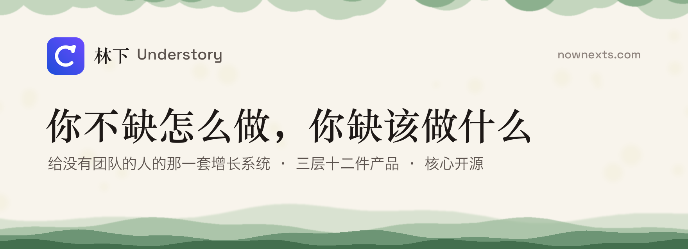
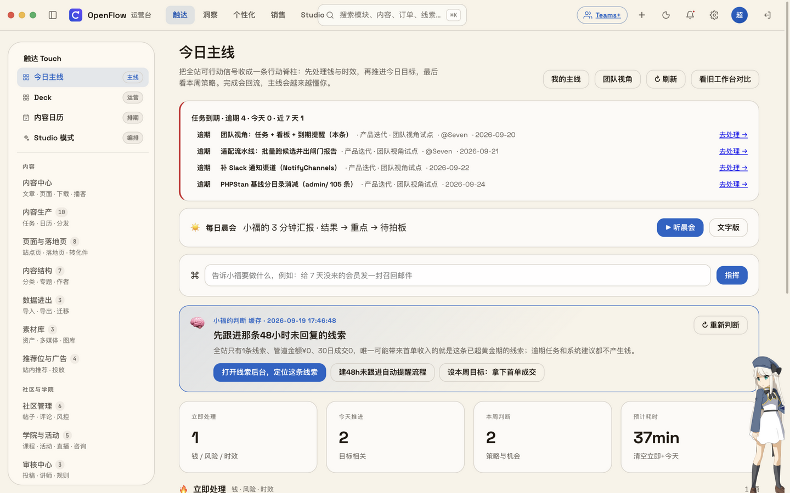
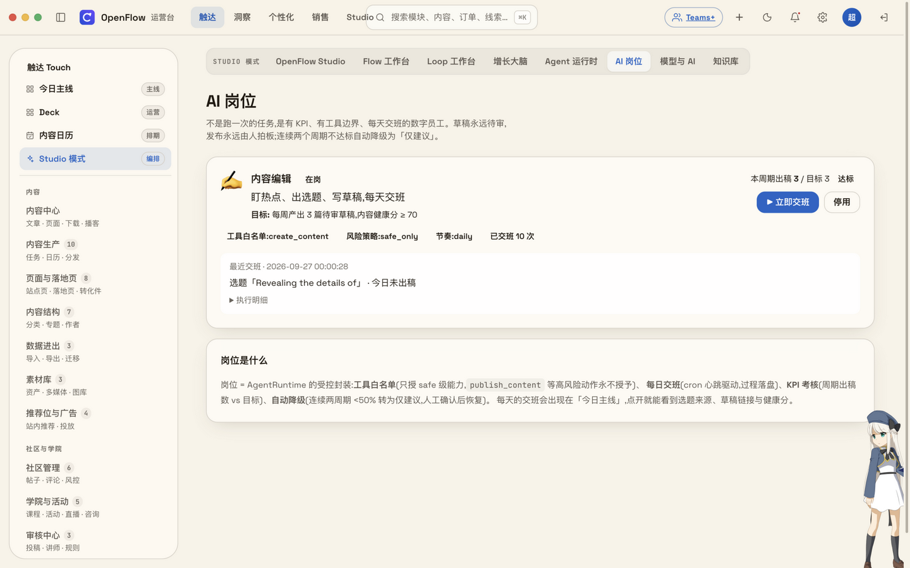
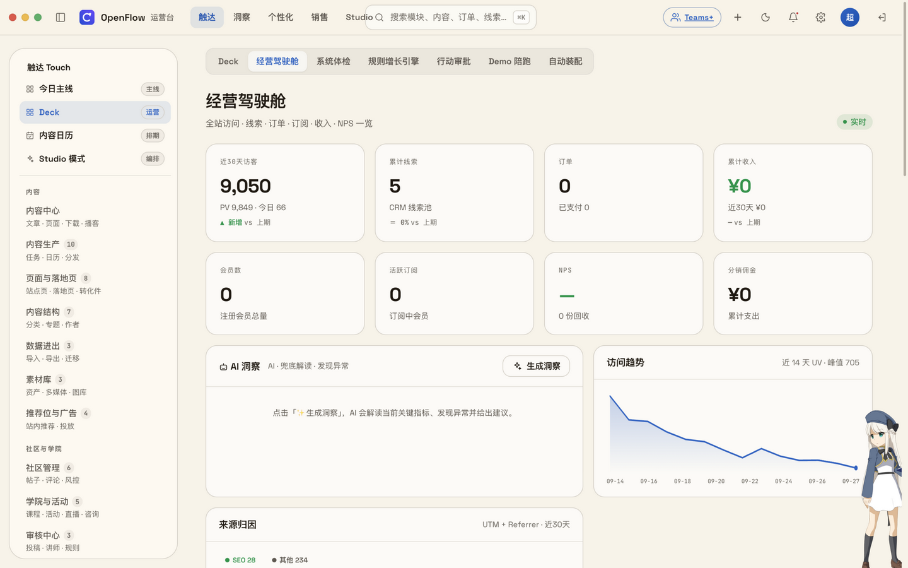
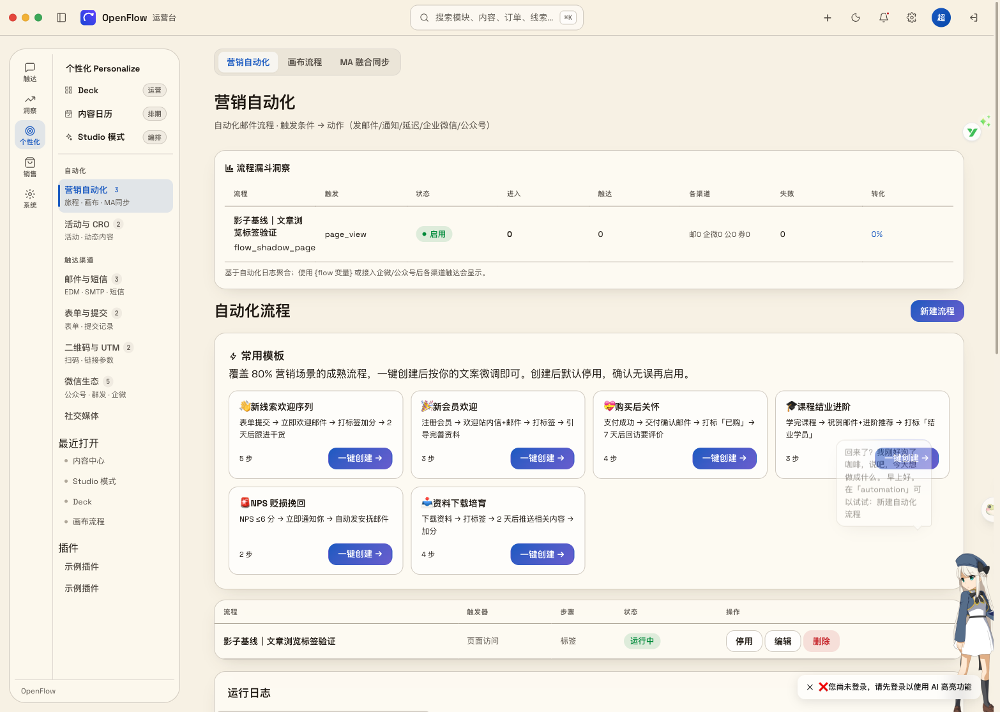

<p align="center">
  <a href="https://nownexts.com"></a>
</p>

<p align="center">
  <b>别人的增长工具，默认你有一支团队。林下 Understory 做的，是给没有团队的人的那一套。</b><br>
  它自己爬信号、自己出草稿、自己盯该跟进谁——你只做判断，不做事。
</p>

<p align="center">
  <a href="https://nownexts.com">官网</a> ·
  <a href="#产品矩阵">产品矩阵</a> ·
  <a href="#快速开始">免费开始</a> ·
  <a href="docs/USAGE-GUIDE.md">文档</a> ·
  <a href="README.en.md">English</a>
</p>

<p align="center">
  <a href="https://nownexts.com"></a>
  <a href="LICENSE"></a>
  <a href="CHANGELOG.md"></a>
</p>

<p align="center"><sub>Seven · 十年增长操盘 · 核心能力永久开源 · 数据在你自己的服务器</sub></p>

---

## 你可能正在经历

- 「每天花 3 小时找选题、改文章，真正该做的判断反而没时间做。」
- 「知道增长该做什么，但哪些交给 Agent、哪些必须自己来，一直没想清楚。」
- 「试了几个工具，最后都变成：还得我自己来。」

营销自动化默认你有市场团队，CRM 默认你有销售，数据分析默认你有分析师。
五个工具，五份等着人来喂的工作。**一人公司缺的从来不是工具，是人。**

## 林下是什么

林下，是树冠之下的那一层：不起眼，却撑着整片林子的生长。一人公司也是这样。

林下 Understory 只服务一种人：一个人扛着一家公司的人。
AI 让「没有人」第一次不等于「做不了」。我们把十二件产品排成三层，哪段缺人，就用哪件补上。

## 产品矩阵

每件都能单独跑、单独见效；互通走公开 API——拔掉任何一个，其余照常运行。

**入口层 · 一整套系统，门槛最低**

| 产品 | 一句话 | 适合谁 | 入口 |
|---|---|---|---|
| **开务 OpenFlow** | 内容、访客数据、自动触达、在线成交，一个人跑得完的增长系统 | 想一次配齐整套系统的一人公司、小团队 | [产品页](https://nownexts.com/product/openflow) · [GitHub](https://github.com/sevenaaaaaaaaa/openflow) · [自托管](#快速开始) |

**进阶层 · Flow 家族，单点更深**

| 产品 | 一句话 | 适合谁 | 入口 |
|---|---|---|---|
| **风媒 MFlow** | AI 生成、多平台分发、轻触达；不换 CMS，不锁模型 | 内容创作者、电商卖家 | [产品页](https://nownexts.com/product/mflow) · [GitHub](https://github.com/sevenaaaaaaaaa/mflow) · [在线体验](https://nownexts.com/mflow/) |
| **魔块 WebsFlow** | 面向投放的落地页工场：出页、上线、看数据、放量，当天闭环 | 投手、活动运营 | [产品页](https://nownexts.com/product/webs-flow) · [GitHub](https://github.com/sevenaaaaaaaaa/websflow) · [在线体验](https://nownexts.com/webflow/) |
| **触级 UserLoop** | 埋点、身份合并、分群，对接任何 MA 的全域数据中枢 | 多平台团队、代理商 | [产品页](https://nownexts.com/product/userloop) · [GitHub](https://github.com/sevenaaaaaaaaa/userloop) |
| **洞澜 inFlow** | 替你盯外部世界：趋势、舆情、竞品，每天给出情报 | 品牌方、内容策划 | [产品页](https://nownexts.com/product/inflow) · [GitHub](https://github.com/sevenaaaaaaaaa/inflow) |
| **芭乐 Pay PayFlow** | 一行代码嵌进任何页面：收款、订阅、老带新返佣 | 创作者、独立开发者 | [产品页](https://nownexts.com/product/payflow) · [GitHub](https://github.com/sevenaaaaaaaaa/payflow) |
| **林下学院 LearnFlow** | 上课、进度、测验、证书，课程交付一个后台管完 | 讲师、教练、训练营主理人 | [产品页](https://nownexts.com/product/learnflow) · [GitHub](https://github.com/sevenaaaaaaaaa/learnflow) |

**工作台层 · Studio，长在你的桌面上**

| 产品 | 一句话 | 适合谁 | 入口 |
|---|---|---|---|
| **鹿蕊 Litmus** | 知识 OS：人随手记、AI 帮你建，知识是磁盘上的普通 Markdown | 知识工作者、开发者 | [产品页](https://nownexts.com/product/litmus) · [GitHub](https://github.com/sevenaaaaaaaaa/litmus) · [下载](https://github.com/sevenaaaaaaaaa/litmus/releases/latest) |
| **松萝 Liana** | 隐私输入法：按键不离开设备，零遥测，P2P 端到端同步 | 重隐私人群、效率用户 | [产品页](https://nownexts.com/product/liana) · [GitHub](https://github.com/sevenaaaaaaaaa/liana) · [下载](https://github.com/sevenaaaaaaaaa/liana/releases/latest) |
| **成章 ConFlow** | 看完一条视频，得到可发布的文章和可放映的幻灯片 | 内容团队、知识博主 | [产品页](https://nownexts.com/product/conflow) · [GitHub](https://github.com/sevenaaaaaaaaa/V2HTML) |
| **林可兔 LinkTo** | 邮件工作台：AI 分类降噪、摘要起草，数据全在本地 | 邮件重度用户、商务人士 | [产品页](https://nownexts.com/product/linkto) · [GitHub](https://github.com/sevenaaaaaaaaa/linkto) · [下载](https://github.com/sevenaaaaaaaaa/linkto/releases/latest) |
| **零真 ZeroZen** | 浏览器扩展：本地规则拦广告和弹窗，规则管不到的交给 AI | 所有浏览器用户 | [产品页](https://nownexts.com/product/zerozen) · [GitHub](https://github.com/sevenaaaaaaaaa/zerozen) · [下载](https://github.com/sevenaaaaaaaaa/zerozen/releases/latest) |

> 鹿蕊、松萝、林可兔、零真，名字都取自林下生态。三层的全貌见 [nownexts.com/product](https://nownexts.com/product)。

## 我该从哪件开始

| 你的情况 | 从这里开始 |
|---|---|
| 只缺收款 / 只缺落地页 / 只缺情报 | PayFlow / WebsFlow / inFlow，零依赖，今天就能用 |
| 投放 → 收款 → 沉淀 | WebsFlow 承接页 + PayFlow 收款 + UserLoop 数据 |
| 一个人当编辑部 | inFlow 情报 + MFlow 生产分发 + UserLoop 效果回流 |
| 卖课、开训练营 | LearnFlow 交付 + PayFlow 收款 + MFlow 触达 |
| 想要一整套，数据在一处 | **OpenFlow** |

从 OpenFlow 开始，因为门槛最低；在 Flow 里变深，因为单点更强；用 Studio 工作，因为矩阵终将长在每个人的桌面上。

## OpenFlow 一天替你干什么

| | |
|---|---|
|  |  |
| **你打开电脑，今天先做什么已经排好。** 全站信号收成一条主线：先处理钱与时效，再推进今日目标。 | **草稿等你改，不用从空白页开始。** AI 岗位每天盯热点、出选题、写稿，发布永远由你拍板。 |
|  |  |
| **哪个来源真的带来成交，一眼看清。** 访客、线索、订单、收入在一张驾驶舱里。 | **你的方法，变成每天自动跑的流程。** 新线索欢迎、购买后关怀，一键创建，确认后再启用。 |

<details>
<summary>它的一天，按时间看</summary>

| 时间 | 它在做什么 |
|---|---|
| 你还没起床 | 爬完行业热点，选题按优先级排好 |
| 你打开电脑 | 草稿等你改；昨天该跟进的人已经列好 |
| 你在忙交付 | 认出老访客，给他看更相关的内容；表单留资自动进 CRM |
| 你下班之后 | 巡检全站：哪页报错、哪页慢、哪块内容是空的 |
| 每周 | 把「哪个来源真的带来成交」算给你 |

运行周期由你设定。
</details>

## TIPS：四件事放进同一条链路

林下的方法论叫 TIPS。四力不是四个功能区，而是一条回路：成交的真相回流洞察，洞察再调整内容与渠道。

| 力 | 它负责 | 承载产品 |
|---|---|---|
| **T** 触达 Touch | 在对的时间、渠道，把内容递到人面前 | OpenFlow · MFlow · 林可兔 LinkTo |
| **I** 洞察 Insight | 从几百个指标里捞出该看的那几个 | UserLoop · inFlow |
| **P** 个性化 Personality | 给对的人，在对的时刻，说对的话 | OpenFlow · UserLoop |
| **S** 销售 Sales | 从触达到成交，让收入流向你 | PayFlow · LearnFlow |

已知的方法交给 Flow 稳定执行；没把握的路径，由受控的 Loop 从建议开始。挡位可以换，方向盘永远在你手里。
想读完整的思路，见 [docs/VISION.md](docs/VISION.md)。

## 快速开始

**先看一眼**：[nownexts.com](https://nownexts.com) 本身就跑在 OpenFlow 上。

**不想碰服务器**：云托管个人版 ¥99/月起，[咨询开通](https://nownexts.com/consultation)。

**自己装（Docker）**：

```bash
git clone https://github.com/sevenaaaaaaaaa/openflow.git && cd openflow
docker compose up -d        # 打开 http://127.0.0.1:8080，按安装向导完成初始化
```

**本地预览（PHP 8.1+）**：

```bash
php -S 127.0.0.1:8080 router.php
```

只需要 PHP 8 + SQLite，不用 MySQL、Redis、Node。服务器部署、cron 心跳、Cloudflare 配置见 [部署指南](docs/DEPLOYMENT.md)。

## 开源与定价

付费买的是省下你的时间，不是解锁功能。

| 方案 | 价格 | 适合谁 |
|---|---|---|
| 开源自部署 | **¥0**，永久 | 动手能力强、在意数据。MIT 协议，全部核心能力 |
| 云托管 · 个人版 | ¥99/月（年付 ¥990） | 一个人的公司，不想管运维 |
| 云托管 · 增长版 | ¥299/月（年付 ¥2,990） | 2–5 人小团队，要席位与权限 |
| 私有化 / 定制 | 按需报价 | 有合规与集成要求的组织 |

以上是 OpenFlow 的价格，[完整对比](https://nownexts.com/pricing)；其他产品见各自产品页。

## 适合谁，不适合谁

| 适合 | 不适合 |
|---|---|
| 一个人（或两三个人）在做的公司、品牌、工作室 | 已有成熟市场团队 + 数据团队的中大型公司——对你们是重复建设 |
| 内容驱动获客：写文章、做课程、接咨询、卖数字产品 | 需要复杂多人审批流的组织 |
| 在意数据自主权，不想把客户名单交给别人的云 | 想要像素级自由设计的品牌官网 |

## 常见问题

<details>
<summary><b>要写代码吗？</b></summary>

不用。四力都能可视化配置；想深入的开发者有 API、Webhook、MCP 和插件可以接。
</details>

<details>
<summary><b>能只用其中一件吗？</b></summary>

能。十二件都独立可用，不要求你先装任何东西。哪天想升级，数据可以平滑并入。
</details>

<details>
<summary><b>数据放在哪？</b></summary>

自部署时，数据 100% 在你自己的服务器，随时导出，无云端回传。云托管的数据也能随时完整导出。
</details>

<details>
<summary><b>AI 要额外花钱吗？</b></summary>

开源版接你自己的模型 Key，费用直接付给模型厂商；云托管含月度额度。没配模型也照样跑，只是不自动写稿。
</details>

<details>
<summary><b>林下和 OpenFlow 是什么关系？</b></summary>

林下 Understory 是品牌与产品矩阵之名，讲方法论、做社区；OpenFlow 是它的入口层，MIT 开源的增长操作系统。方法论告诉你怎么做，OpenFlow 让你真的能做。
</details>

## 用过的人怎么说

> 「一个人做播客加卖课，数据原来散在三个地方。现在选题、发布、转化在一条线上，月底复盘不用再翻六个后台。」
> —— 林之然，播客主理人

> 「开源版装在自己服务器，数据不出域这点对我们行业是硬要求。评估了三个 SaaS，最后是这个谈得最痛快。」
> —— 沈亦舟，财税咨询

## 边界

- AI 的产出都是草稿和建议；发布、群发、价格、支付永远要你确认。
- 「高意向线索 → 成交」的自动闭环还在真实数据里验证；自我进化是方向，不是现状。
- Vercel 等 Serverless 形态只适合演示，生产请用 Docker 或服务器部署。

我们区分已实现、已接入、已被使用、已验证有效，不把远景写成现状。

---

<details>
<summary><b>文档索引</b></summary>

- [使用指南](docs/USAGE-GUIDE.md) · [部署指南](docs/DEPLOYMENT.md) · [功能总附录](docs/APPENDIX-FEATURES.md)
- [产品北极星与设计思路](docs/VISION.md) · [功能地图](docs/PRODUCT-MAP.md)
- [插件开发](docs/PLUGIN-DEV.md) · [MCP 接入](docs/MCP-SETUP.md) · [架构规范](docs/handbook/ARCHITECTURE.md)
- [变更日志](CHANGELOG.md)
</details>

**社区**：[增长社区](https://nownexts.com/community) · [学院](https://nownexts.com/academy) · [GitHub Issues](https://github.com/sevenaaaaaaaaa/openflow/issues) · hello@nownexts.com

**License**：OpenFlow 以 [MIT](LICENSE) 开源。其他产品的协议见各自仓库。

<p align="center"><sub>林下 Understory 出品 · <a href="https://nownexts.com">nownexts.com</a></sub></p>
